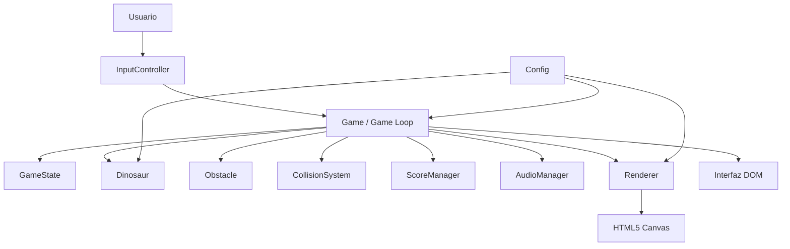

# Dino Run

Videojuego 2D de desplazamiento lateral inspirado en el dinosaurio offline de Chrome. El jugador controla un dinosaurio que corre automáticamente, salta obstáculos y aumenta su puntuación mientras la velocidad crece.

## Objetivo

Construir una experiencia jugable pequeña, explicable y mantenible para demostrar separación de responsabilidades, ciclo de juego y decisiones de arquitectura de software sin depender de frameworks.

## Tecnologías

- HTML5 semántico y Canvas 2D.
- CSS3 responsive.
- JavaScript moderno con módulos ES (`import` / `export`).
- Web Audio API opcional para efectos generados en tiempo real.

## Arquitectura

La aplicación sigue una arquitectura modular orientada a responsabilidades. `Game` coordina los componentes, pero las reglas de cada dominio permanecen encapsuladas en su propio módulo.



### Estructura

```text
.
├── index.html
├── README.md
├── css/
│   └── style.css
└── js/
    ├── main.js
    ├── Game.js
    ├── GameState.js
    ├── Config.js
    ├── Dinosaur.js
    ├── Obstacle.js
    ├── CollisionSystem.js
    ├── ScoreManager.js
    ├── InputController.js
    ├── Renderer.js
    └── AudioManager.js
```

## Componentes principales

- **Game:** orquestador del ciclo principal, cambios de estado, dificultad y reinicio.
- **GameState:** enum único con `MENU`, `PLAYING`, `PAUSED` y `GAME_OVER`.
- **Dinosaur:** encapsula posición, gravedad, salto, animación y hitbox.
- **Obstacle:** representa tipos de obstáculos, movimiento y hitbox.
- **CollisionSystem:** aplica intersección AABB con hitboxes ajustadas para reducir falsos positivos.
- **ScoreManager:** calcula la puntuación y conserva el récord durante la sesión.
- **InputController:** traduce teclado a intenciones consumibles por el juego.
- **Renderer:** dibuja escenario, nubes, dinosaurio, obstáculos y HUD en Canvas.
- **AudioManager:** genera sonidos sin archivos externos y falla de forma segura si el navegador no ofrece audio.
- **main.js:** compone dependencias y conecta eventos de la interfaz.

## Flujo de ejecución

1. `main.js` construye las dependencias y registra los botones.
2. Al iniciar, `Game` reinicia entidades y cambia a `PLAYING`.
3. `requestAnimationFrame` calcula `deltaTime` y ejecuta `update`.
4. `update` consume input, actualiza física, mueve obstáculos, comprueba colisiones y actualiza score.
5. `render` dibuja el estado actual en Canvas y la UI DOM refleja el estado global.
6. Una colisión conserva el récord, reproduce audio y cambia a `GAME_OVER`.

## Patrones y principios

- **State Pattern ligero:** `GameState` representa estados válidos y `Game.setState` centraliza la transición y la sincronización de la UI. Evita combinaciones frágiles de booleanos.
- **Facade / Orchestrator:** `Game` ofrece un punto de coordinación para el loop sin absorber la lógica interna de entidades y servicios.
- **Composición:** las dependencias se inyectan en `Game`, facilitando pruebas futuras con un renderer, reloj o aleatorio sustitutos.
- **SRP:** cada módulo cambia por una razón principal.
- **Open/Closed:** tipos visuales de obstáculos se describen mediante datos y pueden ampliarse sin modificar el loop.
- **Dependency Inversion práctica:** el coordinador recibe servicios (`renderer`, `audio`, `input`, `ui`) en vez de crearlos internamente.
- **DRY y KISS:** configuración compartida en `Config.js`, AABB reutilizable y reglas directas sin abstracciones innecesarias.

## Ejecución local

Por seguridad, los módulos ES deben servirse mediante HTTP local. Desde la carpeta raíz:

```bash
python -m http.server 8000
```

Luego abrir `http://localhost:8000` en el navegador. También puede utilizarse la extensión Live Server de VS Code.

## Controles

- `SPACE` o `FLECHA ARRIBA`: saltar.
- `P`: pausar o continuar.
- Botón superior derecho: pausar o continuar.
- Botones de pantalla: iniciar o reiniciar.

## Decisiones arquitectónicas

Se eligió Canvas porque el juego es una escena 2D con actualización frecuente y pocos objetos; así se evita el coste de manipular muchos nodos DOM. El estado se mantiene en `Game` como fuente única de verdad, mientras que la UI solo representa ese estado. Los efectos de sonido no son un requisito duro y por eso usan Web Audio sin bloquear el juego cuando faltan permisos o soporte.

El tiempo se calcula como `deltaTime` para que la simulación sea consistente entre equipos. La velocidad se limita para conservar jugabilidad, y el intervalo de generación se mantiene dentro de un rango controlado. Las entidades usan hitboxes internas más pequeñas que sus dibujos para que el reto dependa de la geometría útil y no de píxeles decorativos.

## Mejoras futuras

- Pruebas automatizadas para física, AABB y reglas de dificultad.
- Persistencia del récord con `localStorage`.
- Sprites y audio producidos por un artista.
- Más patrones de obstáculos y un sistema de semillas para reproducir partidas.
- Adaptación de accesibilidad para controles alternativos y preferencias de movimiento.
